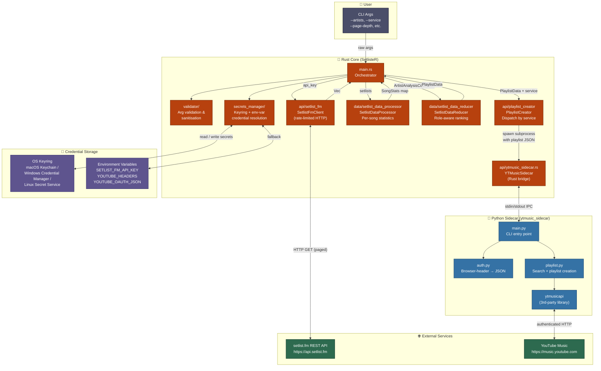
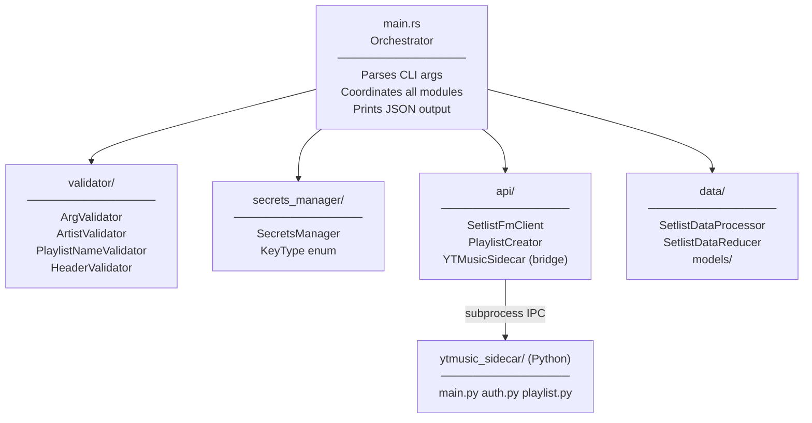
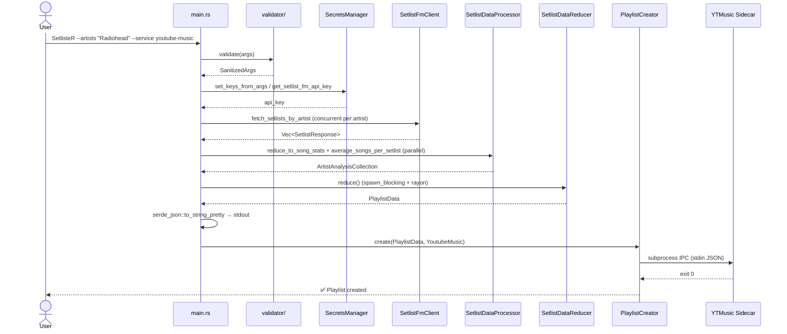
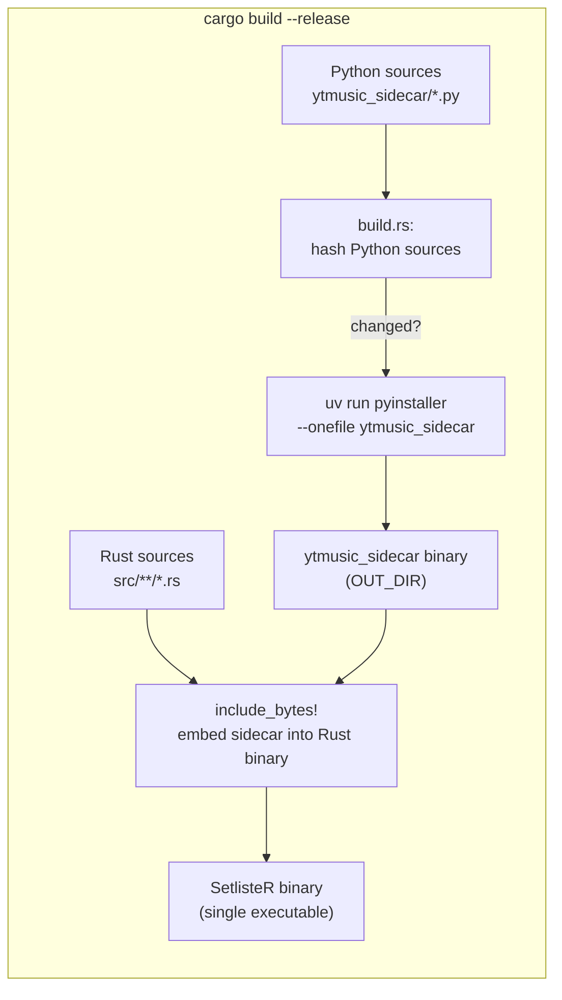
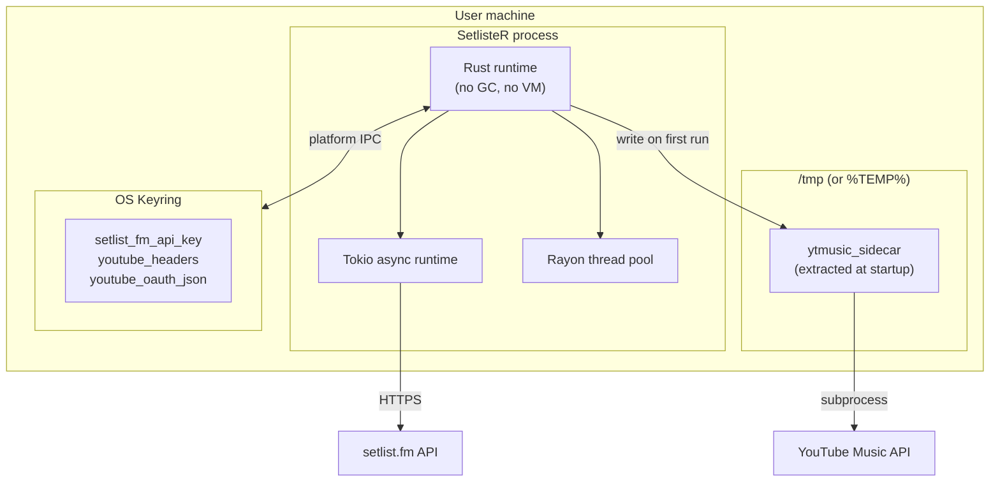

# arc42 Architecture Documentation — SetlisteR

> **Template version:** arc42 8.x  
> **Status:** Living document — update alongside code changes  
> **Last reviewed:** 2026-06  

---

## Table of Contents

1. [Introduction and Goals](#1-introduction-and-goals)
2. [Architecture Constraints](#2-architecture-constraints)
3. [System Scope and Context](#3-system-scope-and-context)
4. [Solution Strategy](#4-solution-strategy)
5. [Building Block View](#5-building-block-view)
6. [Runtime View](#6-runtime-view)
7. [Deployment View](#7-deployment-view)
8. [Cross-cutting Concepts](#8-cross-cutting-concepts)
9. [Architecture Decisions](#9-architecture-decisions)
10. [Quality Requirements](#10-quality-requirements)
11. [Risks and Technical Debt](#11-risks-and-technical-debt)
12. [Glossary](#12-glossary)

---

## 1. Introduction and Goals

### 1.1 Purpose

SetlisteR is a Rust command-line application that transforms live-concert data into ranked, ready-to-listen playlists. Given one or more artist names, it:

1. Fetches historical setlist data from the [setlist.fm](https://www.setlist.fm) REST API.
2. Computes per-song statistics (play counts, positional roles, recency).
3. Applies a role-aware ranking algorithm to produce a setlist-shaped song order.
4. Optionally creates the playlist directly on YouTube Music via a bundled Python sidecar.

### 1.2 Quality Goals

| Priority | Goal | Scenario                                                                                                                            |
|----------|------|-------------------------------------------------------------------------------------------------------------------------------------|
| 1 | **Correctness** | The ranked playlist faithfully reflects a typical live show for the given artists - openers first, closers/encores last.            |
| 2 | **Security** | API keys and session credentials are never stored in plain text on disk; the OS keyring is the primary store.                       |
| 3 | **Performance** | Multiple artists are fetched and analysed concurrently; the critical path is bounded by the setlist.fm rate limit, not by CPU work. |
| 4 | **Portability** | The tool runs identically on macOS, Windows, and Linux without user-visible differences.                                            |
| 5 | **Usability** | A single command with minimal required flags is sufficient for normal use.                                                          |

### 1.3 Stakeholders

| Role | Expectation |
|------|-------------|
| End user | Produces a meaningful playlist with a single shell command. |
| Developer / contributor | Understands module boundaries; can extend a new streaming service without touching core logic. |
| CI / CD pipeline | Builds deterministically; Python sidecar is only rebuilt when its sources change. |

---

## 2. Architecture Constraints

### 2.1 Technical Constraints

| ID | Constraint | Rationale                                                                                                                                                 |
|----|-----------|-----------------------------------------------------------------------------------------------------------------------------------------------------------|
| TC-1 | Rust edition `2024`; MSRV follows Cargo's resolution | Project language choice.                                                                                                                                  |
| TC-2 | Python ≥ 3.9 and `uv` must be available at **build time** | Required by PyInstaller to compile the sidecar. At **run time** no Python installation is needed - the sidecar is embedded in the binary.                 |
| TC-3 | setlist.fm API enforces ≤ 2 requests/second | Implemented as a global 500 ms mutex in `SetlistFmClient`.                                                                                                |
| TC-4 | YouTube Music authentication uses browser session headers, not an official OAuth client | The `ytmusicapi` library reverse-engineers the YouTube Music private API; no official API key exists due to client auth variants beeing currently broken. |
| TC-5 | OS keyring must be reachable at runtime for credential storage | On Linux a Secret Service daemon (e.g. GNOME Keyring, KWallet) must be running. Environment-variable fallback exists.                                     |

### 2.2 Organizational Constraints

| ID | Constraint                                                                                                                                 |
|----|--------------------------------------------------------------------------------------------------------------------------------------------|
| OC-1 | Spotify integration is **not yet implemented** due to spotify switching their api model to premium only, will be implemented in the future |
| OC-2 | The project is open-source (see LICENSE); no proprietary SDKs may be vendored.                                                             |

---

## 3. System Scope and Context

### 3.1 Business Context

```
┌─────────────────────────────────────────────────────────┐
│                       SetlisteR                         │
│                                                         │
│  Input : artist names, streaming service, page depth    │
│  Output: ranked playlist JSON (stdout) + optional       │
│          platform playlist creation                     │
└────────────────────┬────────────────────────────────────┘
                     │
        ┌────────────┼────────────┐
        ▼            ▼            ▼
  setlist.fm    YouTube Music  OS Keyring
  REST API       (via sidecar)  (credentials)
```

| External System | Direction | Protocol / Format |
|----------------|-----------|-------------------|
| **setlist.fm REST API** | Read | HTTPS, JSON (`application/json`), API key in `x-api-key` header |
| **YouTube Music** | Write | HTTPS via `ytmusicapi` (Python); browser-session auth |
| **OS Keyring** | Read/Write | Platform-native IPC (D-Bus / XPC / DPAPI) |
| **Standard I/O** | Read (headers) / Write (JSON) | Text over stdin/stdout |

### 3.2 Technical Context

See [architecture.md](./architecture.md) for the full system diagram, reproduced here for reference:



---

## 4. Solution Strategy

| Decision | Choice | Justification |
|----------|--------|--------------|
| **Implementation language** | Rust | Memory safety without GC; `async`/`await` via Tokio for I/O-bound fetching; Rayon for CPU-bound parallelism. |
| **YouTube Music integration** | Embedded Python sidecar (PyInstaller binary) | No Rust-native `ytmusicapi` equivalent exists. Bundling avoids a runtime Python dependency — the sidecar binary is extracted to `/tmp` at startup. |
| **Credential storage** | OS keyring (`keyring-core`) with env-var fallback | Keeps secrets out of shell history and config files; the layered fallback (keyring → env var) supports CI/CD and Docker environments that lack a keyring daemon. |
| **Concurrency model** | `tokio::task::JoinSet` for I/O, `rayon::par_iter` for CPU | Fetching is I/O-bound (network latency + rate limiting); analysis and reduction are CPU-bound and embarrassingly parallel per artist. |
| **Build system** | `cargo build` + `build.rs` calling `uv run pyinstaller` | Single build command produces a self-contained binary; the sidecar is only rebuilt when its Python sources change (content-hash stamp). |
| **Output format** | JSON to stdout, `serde_json` | Machine-readable; easy to pipe to other tools or scripts. |

---

## 5. Building Block View

### 5.1 Level 1 — Top-level modules



### 5.2 Level 2 — Module responsibilities

#### `validator/`

| Component | Responsibility |
|-----------|---------------|
| `ArgValidator` | Orchestrates all sub-validators; produces the `SanitizedArgs` struct passed to `main`. |
| `ArtistValidator` | Splits comma-separated input; deduplicates; enforces max 10 artists, max 100 chars per name; strips non-ASCII characters. |
| `PlaylistNameValidator` | Normalises whitespace; enforces max 100 chars; auto-generates `"<Artist> Setlist"` when omitted. |
| `HeaderValidator` | Reads raw YouTube browser headers from stdin when `--youtube-headers -` is passed. |

#### `secrets_manager/`

| Component | Responsibility |
|-----------|---------------|
| `SecretsManager` | Initialises the OS-appropriate keyring backend once (via `std::sync::Once`). Reads and writes the three credential slots: setlist.fm API key, YouTube headers, YouTube OAuth JSON. Provides env-var fallback for each. |
| `KeyType` | Enum discriminating the credential type written from CLI args (`SetlistFmApiKey`, `YouTubeHeaders`). |

#### `api/`

| Component | Responsibility |
|-----------|---------------|
| `SetlistFmClient` | Paged HTTP GET to `api.setlist.fm`. Enforces the 2 req/s rate limit via a shared `Arc<Mutex<Instant>>`. |
| `PlaylistCreator` | Dispatches playlist creation by `StreamingService`. Currently only `YoutubeMusic` is implemented. |
| `YTMusicSidecar` (Rust) | Extracts the PyInstaller binary from the compiled binary (via `include_bytes!`), writes it to the OS temp directory, sets executable permissions on Unix, and communicates with it via subprocess stdin/stdout. |

#### `data/`

| Component | Responsibility |
|-----------|---------------|
| `SetlistDataProcessor` | Iterates over raw `Setlist` objects; builds a `HashMap<String, SongStats>` accumulating play counts, opener/closer/encore counts, all played positions, and last-played date. |
| `SetlistDataReducer` | Takes the `ArtistAnalysisCollection`; selects the top-N songs by play count; assigns role buckets; produces the final position-ordered `BTreeMap<usize, String>`. |
| `models/` | Pure data types: `Args`, `StreamingService`, `Setlist`/`SetlistResponse`, `SongStats`, `ArtistAnalysis`, `PlaylistData`, `ArtistPlaylist`. |

#### `ytmusic_sidecar/` (Python package)

| Component | Responsibility |
|-----------|---------------|
| `main.py` | `argparse` CLI with two sub-commands: `login` and `create-playlist`. |
| `auth.py` | Accepts raw browser headers; writes a `browser.json` auth file; returns OAuth session JSON. |
| `playlist.py` | Reads `PlaylistData` JSON from stdin; searches YouTube Music for each song; creates the playlist and adds all found tracks. |

### 5.3 Data model overview

See [data_pipeline.md](./data_pipeline.md) for the full transformation diagram.

Key types:

```
SetlistResponse → Setlist → Set → Song
                                    │
                                    ▼
                              SongStats
                         ┌─────────────────────────┐
                         │ song_name : String       │
                         │ total_plays : u32        │
                         │ opener_count : u32       │
                         │ closer_count : u32       │
                         │ encore_count : u32       │
                         │ positions_played : Vec   │
                         │ mean_positions_played: V │
                         │ last_played : String     │
                         └─────────────────────────┘
                                    │
                          ArtistAnalysis
                                    │
                          ArtistAnalysisCollection
                                    │
                              PlaylistData
                         ┌──────────────────────────┐
                         │ playlist_name : String    │
                         │ platforms : Vec<Service>  │
                         │ artist_playlists : Vec<…> │
                         └──────────────────────────┘
```

---

## 6. Runtime View

### 6.1 Happy-path execution

See [main_flow.md](./main_flow.md) for the annotated flowchart. The sequence at a high level:



### 6.2 Credential setup flow

See [secrets_flow.md](./secrets_flow.md) for the full decision tree.

The three credentials resolved at runtime and their lookup order:

| Credential | Keyring key | Env-var fallback |
|-----------|------------|-----------------|
| setlist.fm API key | `setlist_fm_api_key` | `SETLIST_FM_API_KEY` |
| YouTube browser headers | `youtube_headers` | `YOUTUBE_HEADERS` |
| YouTube OAuth JSON (cached) | `youtube_oauth_json` | `YOUTUBE_OAUTH_JSON` |

> **Note:** When YouTube headers are updated via `--youtube-headers`, the cached `youtube_oauth_json` and legacy OAuth entries are **invalidated** automatically so that a fresh login is triggered.

### 6.3 YouTube Music sidecar IPC

See [ytmusic_sidecar_flow.md](./ytmusic_sidecar_flow.md) for the full sequence diagram.

The sidecar binary is embedded in the Rust binary at compile time using `include_bytes!` and extracted to the OS temp directory at runtime. The Rust process communicates with it via two sub-commands:

| Sub-command | Trigger | IPC mechanism |
|------------|---------|---------------|
| `login --headers <raw> --output-file <path>` | First run / headers updated | Headers passed as CLI arg; OAuth JSON returned via file |
| `create-playlist` | Always when `--service youtube-music` | `PlaylistData` JSON written to stdin; exit code signals success |

### 6.4 Rate limiting

The setlist.fm API allows approximately 2 requests per second. `SetlistFmClient` enforces this with a single `Arc<Mutex<Instant>>` shared across all concurrent artist tasks:

```
Task A ─► acquires lock ─► waits if next_allowed < now ─► updates next_allowed += 500ms ─► releases
Task B ─►                  blocks until Task A releases ─► same flow
```

This serialises individual HTTP requests while allowing the higher-level artist-task concurrency to remain fully async.

---

## 7. Deployment View

### 7.1 Build process



Key properties of the build:
- **Incremental sidecar builds:** `build.rs` hashes `main.py`, `auth.py`, `playlist.py`, and `pyproject.toml`. The PyInstaller step is skipped if the hash matches the stamp file.
- **No Python at runtime:** The compiled sidecar (a self-contained PyInstaller one-file bundle) is embedded via `include_bytes!` and extracted to `/tmp` on first use.
- **Cross-platform binary names:** `ytmusic_sidecar.exe` on Windows, `ytmusic_sidecar` elsewhere.

### 7.2 Runtime environment



### 7.3 Platform matrix

| Platform | Keyring backend | Sidecar binary | Notes |
|---------|----------------|----------------|-------|
| macOS | `apple-native-keyring-store` (Keychain) | `ytmusic_sidecar` | |
| Windows | `windows-native-keyring-store` (Credential Manager) | `ytmusic_sidecar.exe` | |
| Linux | `dbus-secret-service-keyring-store` (Secret Service) | `ytmusic_sidecar` | Requires a running Secret Service daemon |
| Tests | `keyring_core::mock::Store` | N/A | Mocked keyring; no daemon needed |

---

## 8. Cross-cutting Concepts

### 8.1 Error handling

SetlisteR uses Rust's `Result<T, E>` throughout and follows a consistent strategy:

| Layer | Strategy |
|-------|----------|
| Argument validation | `Err(String)` propagated to `main`; printed to `stderr` then `process::exit(1)` |
| Secrets manager | `Option<String>` returned; caller decides whether absence is fatal |
| API fetching | `Result<SetlistResponse, String>` per page; failed pages are logged to `stderr` and skipped (resilient collection) |
| Playlist creation | `expect(…)` — failure is considered unrecoverable at this stage |
| Sidecar IPC | `Result<(), String>` propagated; `expect(…)` in `create_youtube_music_playlist` |

### 8.2 Credential security

- Credentials are written to the OS keyring using `keyring-core`; they are never written to disk in plaintext.
- When YouTube headers are refreshed (`--youtube-headers`), all derived cached credentials (`youtube_oauth_json`, legacy OAuth entries) are **proactively deleted** from the keyring to prevent stale-session attacks.
- The stdin path (`--youtube-headers -`) reads headers without ever echoing them to the terminal.
- Environment variables are supported as a fallback for CI/CD contexts where no keyring daemon is available.

### 8.3 Concurrency model

See [ranking_algorithm.md](./ranking_algorithm.md) (Concurrency Model section) for the diagram.

| Work type | Mechanism | Why |
|-----------|----------|-----|
| Fetching setlists per artist | `tokio::task::JoinSet` (async) | I/O-bound; blocked on network latency and the 500 ms rate-limit slot |
| Analysing setlists per artist | `rayon::par_iter` | CPU-bound; embarrassingly parallel per artist |
| Reducing playlists | `tokio::task::spawn_blocking` → `rayon::par_iter` | Blocking CPU work offloaded from the async runtime |

### 8.4 Input sanitisation

All user-supplied strings are sanitised by the `validator/` module before use:

| Input | Sanitisation applied |
|-------|---------------------|
| Artist names | Split on `,`; trim; deduplicate; strip non-ASCII; enforce ≤ 10 artists, ≤ 100 chars each |
| Playlist name | Trim; collapse inner whitespace; strip non-ASCII; enforce ≤ 100 chars; auto-truncate when auto-generated |
| YouTube headers | Read from stdin if value is `-`; passed to Python sidecar for further parsing |

### 8.5 Observability

The application currently uses simple `println!` / `eprintln!` for output:
- **stdout** receives the `PlaylistData` JSON (machine-readable, pipeable).
- **stderr** receives progress messages, warnings, and errors from both the Rust core and the Python sidecar.

---

## 9. Architecture Decisions

### ADR-001 — Rust as the implementation language

**Context:** A CLI tool with network I/O and non-trivial data processing logic is needed.  
**Decision:** Use Rust with Tokio (async) and Rayon (parallel CPU work).  
**Consequences:** Strong memory safety guarantees; no runtime overhead; excellent cross-compilation support. Steeper learning curve than Python or Go, but justified by the concurrency model requirements.

### ADR-002 — Python sidecar for YouTube Music

**Context:** No mature Rust library wraps the YouTube Music private API. The `ytmusicapi` Python library is the de-facto standard.  
**Decision:** Bundle a PyInstaller-compiled Python binary inside the Rust binary using `include_bytes!`. The sidecar is extracted to `/tmp` at runtime and invoked as a subprocess.  
**Consequences:**  
- ✅ No Python runtime required on the end-user machine.  
- ✅ Clean IPC boundary (stdin/stdout JSON + exit codes).  
- ⚠️ Binary size increases significantly (PyInstaller bundles CPython).  
- ⚠️ Any change to Python sources triggers a full PyInstaller rebuild.

### ADR-003 — OS keyring as the primary credential store

**Context:** The setlist.fm API key and YouTube session headers must be stored securely between invocations.  
**Decision:** Use `keyring-core` with platform-native backends. Support environment variables as a fallback.  
**Consequences:**  
- ✅ Credentials never touch the filesystem in plaintext.  
- ✅ Works transparently across macOS, Windows, and Linux.  
- ⚠️ Linux requires a Secret Service daemon; headless/Docker environments must use env vars.

### ADR-004 — Role-bucket ranking algorithm

**Context:** A naive "most-played songs" list does not reflect the structure of a live concert (openers are played early, encores at the end).  
**Decision:** Assign each song a `RoleBucket` (Opener / Regular / Closer / Encore) based on its play-rate in that role exceeding a configurable threshold (≥ 3 plays, ≥ 60% rate). Sort by bucket first, then by role-specific secondary criteria.  
**Consequences:**  
- ✅ The output playlist mirrors the arc of a real show.  
- ⚠️ Songs with fewer than 3 plays always fall into Regular regardless of actual role — acceptable with small page-depth values.  
- ⚠️ The `TARGET_SETLIST_SIZE_OFFSET` constant (+3 songs) compensates for festival/short-show bias in the average; this is an empirical value that may need tuning.

See [ranking_algorithm.md](./ranking_algorithm.md) for the full algorithm flowchart.

### ADR-005 — Single output format (JSON to stdout)

**Context:** The tool needs to communicate playlist data to both the user and the platform-specific integration.  
**Decision:** Always serialise `PlaylistData` to pretty-printed JSON on stdout. The same struct is passed to the sidecar via stdin.  
**Consequences:**  
- ✅ Easily piped to `jq`, scripts, or other tools.  
- ✅ The Rust ↔ Python IPC reuses the same serialised format.  
- ⚠️ Not human-friendly for quick review; a `--format table` flag would improve UX (future work).

---

## 10. Quality Requirements

### 10.1 Quality tree

```
Quality
├── Correctness
│   ├── Role assignment reflects actual live performance patterns
│   └── Song statistics are accumulated without double-counting tape tracks
├── Security
│   ├── No plaintext credential storage on disk
│   └── Stale credentials are invalidated when headers are refreshed
├── Performance
│   ├── Multiple artists fetched concurrently (bounded by API rate limit only)
│   └── Analysis and reduction are parallelised across artists via Rayon
├── Portability
│   ├── Identical behaviour on macOS, Windows, Linux
│   └── No runtime Python dependency for end users
└── Usability
    ├── Single required flag pair (--artists, --service)
    └── Auto-generated playlist name when --playlist-name is omitted
```

### 10.2 Quality scenarios

| ID | Quality | Stimulus | Response |
|----|---------|----------|----------|
| QS-1 | Correctness | Artist has 50 shows; opener song played in position 1 in 45 of them | Song is assigned `RoleBucket::Opener` and placed at position 1 in the output playlist |
| QS-2 | Security | User runs `--youtube-headers -` and pastes headers | Headers read from stdin (not visible in process list); stored in OS keyring; never written to disk |
| QS-3 | Performance | User requests 5 artists with `--page-depth 3` (15 HTTP calls) | All 15 calls are rate-limited to ≤ 2/s globally; total time ≈ 7.5 s network + negligible CPU |
| QS-4 | Portability | User runs on Linux without a Secret Service daemon | Application falls back to `SETLIST_FM_API_KEY` env var; prints keyring warning to stderr but continues |
| QS-5 | Usability | User omits `--playlist-name` for a single artist "Muse" | Playlist is named `"Muse Setlist"` automatically |

---

## 11. Risks and Technical Debt

| ID | Risk / Debt | Severity | Mitigation / Plan |
|----|------------|----------|-------------------|
| R-1 | **Spotify integration is a stub** — `PlaylistCreator` prints "not yet implemented" for Spotify. | Medium | Architecture already supports it via `StreamingService` dispatch; requires a Spotify API client and OAuth flow. |
| R-2 | **YouTube Music session expiry** — Browser session headers expire; no automatic refresh mechanism exists. | High | User must re-run with `--youtube-headers -`. A token-refresh loop in the sidecar would improve UX. |
| R-3 | **PyInstaller binary size** — Bundling CPython significantly increases the distributed binary size. | Low | Acceptable trade-off for zero runtime dependency. Could be mitigated with a slim CPython build. |
| R-4 | **setlist.fm search ambiguity** — The API searches by artist name string; artists with similar names may return mixed results. | Medium | No current mitigation. An artist MBID (MusicBrainz ID) lookup could disambiguate. |
| R-5 | **`TARGET_SETLIST_SIZE_OFFSET` is a magic constant** — The `+3` offset compensating for festival setlists is empirical and untested across diverse artists. | Low | Should be made configurable via a CLI flag or derived adaptively from the variance in setlist length. |
| R-6 | **No structured logging** — All output uses `println!`/`eprintln!`; log levels and structured output are absent. | Low | Introduce `tracing` crate for structured, levelled logging. |
| R-7 | **Artist name strips non-ASCII silently** — `ArtistValidator::strip_non_unicode` discards non-ASCII characters without warning. | Medium | Should warn the user and potentially fail rather than silently mutate the input. |

---

## 12. Glossary

| Term | Definition |
|------|-----------|
| **arc42** | A pragmatic, lightweight template for documenting software architectures, consisting of 12 sections. |
| **Closer** | A song that frequently ends a set (non-encore). Assigned `RoleBucket::Closer` when closer_rate ≥ 60% with ≥ 3 plays. |
| **Encore** | A song played after the main set, typically after the band has left the stage. Assigned `RoleBucket::Encore` when encore_rate ≥ 60% with ≥ 3 plays. |
| **Opener** | The first song of a show. Assigned `RoleBucket::Opener` when opener_rate ≥ 60% with ≥ 3 plays. |
| **Page depth** | The number of result pages fetched from the setlist.fm API per artist. Each page contains up to 20 setlists. Controlled by `--page-depth`. |
| **PlaylistData** | The central output struct containing the playlist name, target platforms, and per-artist ordered song lists. |
| **RoleBucket** | An enum (`Opener`, `Regular`, `Closer`, `Encore`) used to sort songs into their typical position within a live set. |
| **setlist.fm** | A crowd-sourced database of concert setlists. SetlisteR consumes its REST API. |
| **Sidecar** | The Python binary bundled inside the Rust binary. It handles YouTube Music API calls that have no Rust-native equivalent. |
| **SongStats** | A struct accumulating play-count, role-count, position, and recency data for a single song across all fetched setlists. |
| **Tape** | A song played from a recording (not performed live). Tape songs are excluded from all statistics. |
| **Target setlist size** | `ceil(average_songs_per_setlist) + 3`. The number of songs selected from the full song pool before role-based ranking. |
| **ytmusicapi** | An open-source Python library that reverse-engineers the YouTube Music private API using browser session authentication. |
