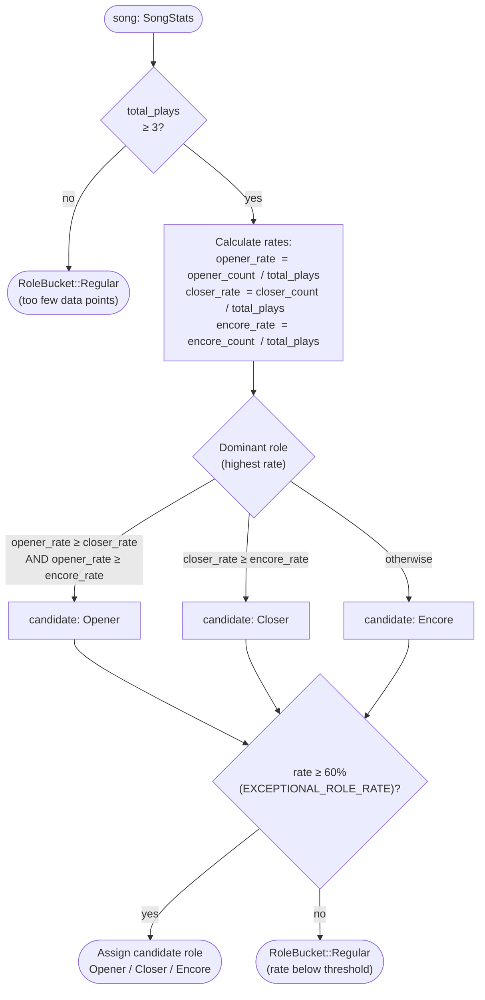
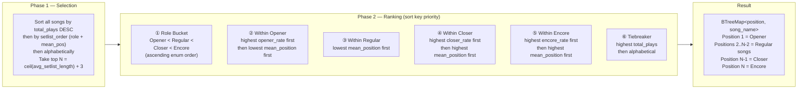
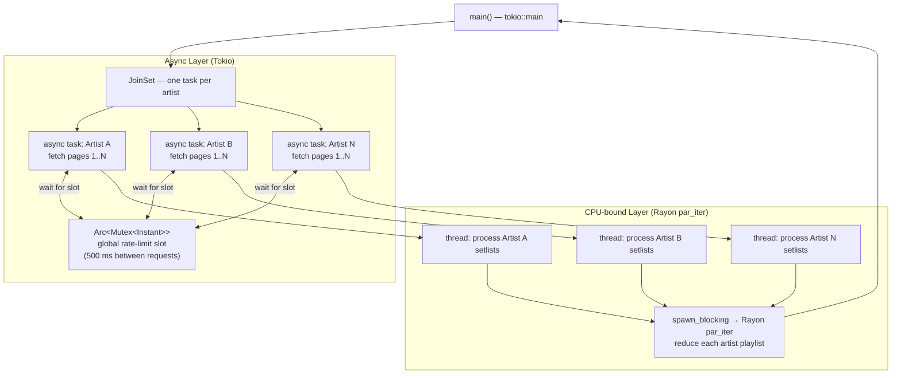

# SetlisteR — Song Ranking Algorithm

How `SetlistDataReducer` assigns a role to each song and orders the final playlist.

## Role Assignment

## Playlist Ordering (within a single artist)

## Concurrency Model

